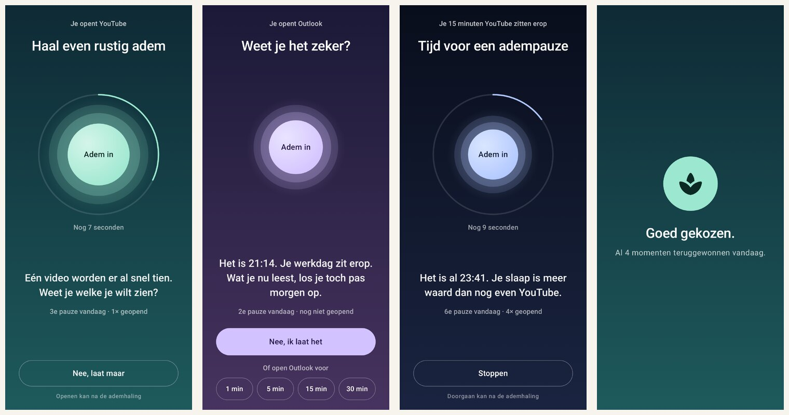
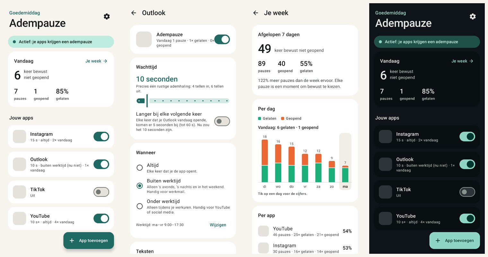

# Adempauze

Een Android-app die je een korte adempauze geeft voordat je een app opent.
Open je YouTube, Instagram of je werkmail, dan schuift er eerst een rustig
scherm overheen:

1. **Haal even rustig adem.** Een cirkel die meebeweegt met je ademhaling:
   4 tellen in, 6 tellen uit. De standaardpauze van 10 seconden is precies één
   ademhaling.
2. **Een vraag die bij de app past.** Bij YouTube: *"Eén video worden er al snel
   tien. Weet je welke je wilt zien?"* Bij werkmail om negen uur 's avonds:
   *"Het is 21:14. Je werkdag zit erop. Wat je nu leest, los je toch pas morgen
   op."*
3. **Weet je het zeker?** Na de ademhaling kies je: **Nee, ik laat het** (terug
   naar het startscherm), of open de app voor 1, 5, 15 of 30 minuten.
4. **Je tijd is om.** Zit je na die minuten nog in de app, dan komt de
   adempauze terug: *"Wil je echt verder?"*




---

## Wat bestaande apps doen, en wat Adempauze beter doet

Ik heb gekeken naar de bekendste apps in deze hoek.

- **[one sec](https://one-sec.app/android)** laat bij het openen van een app
  een ademhalingsoefening zien en vraagt daarna of je nog door wilt. Het
  gebruikt op Android ook de toegankelijkheidsdienst. Een
  [onderzoek in PNAS (2023)](https://pmc.ncbi.nlm.nih.gov/articles/PMC9974409)
  met de app vond na zes weken gemiddeld **57% minder** keer openen. Opvallend
  uit dat onderzoek: de knop om af te zien van openen had het grootste effect,
  de wachttijd hielp ook, en een tekst alléén deed weinig.
- **[ScreenZen](https://play.google.com/store/apps/details?id=com.screenzen)**
  laat een wachtscherm zien met een vraag als *"Is dit belangrijk?"*. De
  wachttijd kan oplopen met elke keer openen, en je kunt per tijdstip
  instellen wanneer het geldt.
- Een [vervolgonderzoek (CHI 2024)](https://www.medien.ifi.lmu.de/pubdb/publications/pub/haliburton2024chi/haliburton2024chi.pdf)
  met ruim duizend gebruikers zag dat mensen zulke apps vaak tijdelijk
  uitzetten en dan snel terugvallen.

Adempauze neemt het beste van beide en bouwt verder op wat het onderzoek zegt:

- **De ademhaling is één echte ademhaling.** 4 tellen in, 6 uit: een langere
  uitademing kalmeert. De cirkel, de tekst *Adem in / Adem uit* en een zacht
  tikje van de trilmotor lopen gelijk op.
- **"Nee, laat maar" staat er vanaf de eerste seconde**, groot en na de
  ademhaling als hoofdknop. Kies je hem, dan krijg je een kort *"Goed
  gekozen"* en ga je naar je startscherm.
- **De vraag past bij de app én het moment.** Andere teksten voor video,
  social media, werkmail, gewone mail, berichten, nieuws, winkelen, games en
  browsers. 's Nachts gaat het over slaap, 's ochtends over je dag beginnen,
  en bij de vijfde poging op een dag benoemt hij dat ook. Met eigen zinnen per
  app, die vaker voorbijkomen.
- **Werkmail alleen buiten werktijd.** Per app kies je *altijd*, *buiten
  werktijd* of *onder werktijd*. Zo kun je overdag gewoon je mail lezen en
  krijg je 's avonds en in het weekend wél een adempauze.
- **Jij kiest hoe lang.** Open een app voor 1, 5, 15 of 30 minuten. Daarna
  komt de vraag terug: *"Wil je echt verder?"*
- **Een wachttijd die mag oplopen.** Optioneel: elke keer dat je de app
  vandaag opende, wacht je 5 seconden langer.
- **Uitzetten kost ook even moeite.** Een pauze uitzetten of een app
  verwijderen kan pas na 10 seconden wachten, tegen het terugvallen dat het
  CHI-onderzoek zag.
- **Je ziet je vooruitgang.** Per dag en per app hoe vaak je een app liet
  liggen, en of het minder wordt dan de week ervoor.
- **Gratis, zonder account en zonder internet.**

## Installeren op je Samsung

Adempauze staat niet in de Play Store. Je installeert de APK zelf; dat duurt
een paar minuten en hoeft maar één keer.

1. **Download de app.** Open op je telefoon
   **https://github.com/sblvanegmond/App-lading-car/releases/download/adempauze/adempauze.apk**
   (of de releasepagina
   `https://github.com/sblvanegmond/App-lading-car/releases/tag/adempauze`).
2. **Installeren toestaan.** Tik op de download. Vraagt je telefoon of de
   browser apps mag installeren, zet dat dan aan.
   - Zegt Samsung dat de installatie is **geblokkeerd door Automatische
     blokkering** (Auto Blocker): ga naar *Instellingen › Beveiliging en
     privacy › Automatische blokkering*, zet het tijdelijk uit, installeer, en
     zet het daarna weer aan.
   - Waarschuwt Play Protect voor een onbekende app: tik op *Meer details ›
     Toch installeren*. Adempauze heeft geen internettoegang en verstuurt niets.
3. **Open Adempauze** en tik op *Aan de slag*. De app leidt je door de
   volgende stappen.
4. **Toegankelijkheid aanzetten.** *Instellingen › Toegankelijkheid ›
   Geïnstalleerde apps › Adempauze* › aan.
5. **Melding "Beperkte instelling"?** Dat krijg je bij apps die niet uit de
   Play Store komen. Ga naar *Instellingen › Apps › Adempauze*, tik rechtsboven
   op **⋮** en kies **Beperkte instellingen toestaan**. Doe daarna stap 4
   opnieuw. (Die optie verschijnt pas nadat Android de schakelaar één keer heeft
   tegengehouden.)
6. **Batterij op onbeperkt.** Adempauze vraagt dit zelf. Zo zet Samsung de app
   niet "in slaap". Het kost vrijwel geen stroom.
7. **Apps kiezen.** Tik op *Apps kiezen*. Bovenaan staan voorstellen zoals
   YouTube, Instagram, Outlook en Gmail.

Een nieuwe versie installeer je op dezelfde manier; die gaat over de oude heen
en je instellingen en statistieken blijven bewaard.

## Gebruik

- **Per app instellen** (tik op een app in de lijst):
  - *Wachttijd*: 5 tot 60 seconden. Standaard 10.
  - *Langer bij elke volgende keer*: elke keer dat je de app vandaag opende,
    komen er 5 seconden bij.
  - *Wanneer*: altijd, alleen **buiten werktijd** (voor werkmail) of alleen
    **onder werktijd** (voor YouTube en social media).
  - *Soort app*: bepaalt welke vragen je ziet.
  - *Eigen zinnen*: bijvoorbeeld *"Je wilde vanavond toch lezen?"*. Je kunt
    `{app}` en `{tijd}` gebruiken.
  - *Probeer het pauzescherm*: zie direct hoe het eruitziet.
- **Werktijd** stel je in onder *Instellingen* (standaard ma–vr 9:00–17:30).
- **Je week** laat zien hoe vaak je een app liet liggen en hoe vaak je hem
  opende, per dag en per app.
- Een pauze **uitzetten** of een app **verwijderen** kan, maar ook dan wacht je
  eerst 10 seconden. Zo zet je Adempauze niet in een opwelling uit.

## Privacy

- Geen internettoegang (de app vraagt die toestemming niet eens), geen account,
  geen reclame.
- De toegankelijkheidsdienst krijgt alleen te horen *welke* app vooraan komt.
  Hij leest geen tekst op je scherm (`canRetrieveWindowContent="false"`).
- Alles staat in de app-opslag op je telefoon. Statistieken ouder dan 90 dagen
  worden opgeruimd.

## Hoe het werkt

| Onderdeel | Bestand |
|---|---|
| Ziet welke app vooraan komt en legt het pauzescherm eroverheen | `service/GuardService.kt` |
| Beslist of de pauze moet verschijnen (pas, dubbele vensters) | `service/Interceptor.kt` |
| Het pauzescherm met ademhaling en keuzes | `ui/pause/PauseActivity.kt`, `ui/pause/PauseScreen.kt` |
| Wachttijd, werktijd, soort app herkennen | `core/Policy.kt` |
| Alle teksten en hoe er een gekozen wordt | `core/Messages.kt` |
| Opslag op de telefoon | `data/Repository.kt`, `data/Codec.kt` |
| Hoofdscherm, app kiezen, instellingen, week | `ui/main/` |

De paden zijn relatief aan `app/src/main/java/nl/adempauze/`.

Wil je teksten toevoegen of aanpassen: alles staat in `core/Messages.kt`, per
soort app en per moment van de dag.

## Zelf bouwen

Nodig: JDK 17 of nieuwer en de Android SDK (platform 36).

```bash
cd adempauze
./gradlew testDebugUnitTest   # unit-tests + schermafbeeldingen in app/build/screenshots
./gradlew assembleRelease     # app/build/outputs/apk/release/app-release.apk
```

De workflow `.github/workflows/adempauze.yml` doet hetzelfde bij elke push en
vervangt de release met de tag `adempauze`. Die staat bewust als
*pre-release*, zodat hij nooit "latest" wordt en de downloadlink van Laadmoment
(`releases/latest/…`) blijft werken.

### Ondertekening

De APK wordt ondertekend met `signing/adempauze-sideload.jks` uit deze
repository. Dat is bewust: zo heeft elke versie dezelfde handtekening en
installeert een update altijd over de vorige heen. Die sleutel is dus geen
geheim; hij bewijst alleen dat een update van "dezelfde" Adempauze komt.
Installeer daarom alleen APK's van je eigen releasepagina. Wil je een eigen,
geheime sleutel gebruiken, zet dan `ADEMPAUZE_KEYSTORE`,
`ADEMPAUZE_KEYSTORE_PASSWORD`, `ADEMPAUZE_KEY_ALIAS` en `ADEMPAUZE_KEY_PASSWORD`
(lokaal of als secrets in de workflow). Let op: na een sleutelwissel moet je de
oude versie eerst verwijderen.

## Grenzen

- De app die je opent, is heel even zichtbaar voordat de pauze eroverheen
  schuift. Zo werkt het bij alle apps van dit soort op Android.
- Kies je "openen voor 5 minuten" en ga je tussendoor even naar een andere app,
  dan loopt die tijd door. Kom je binnen die 5 minuten terug, dan krijg je geen
  nieuwe pauze.
- Apps in een gesplitst scherm of pop-upvenster worden niet altijd herkend.
- Wie echt wil, kan de toegankelijkheidsdienst uitzetten. Adempauze maakt het
  bewust lastiger in een opwelling, niet onmogelijk.
